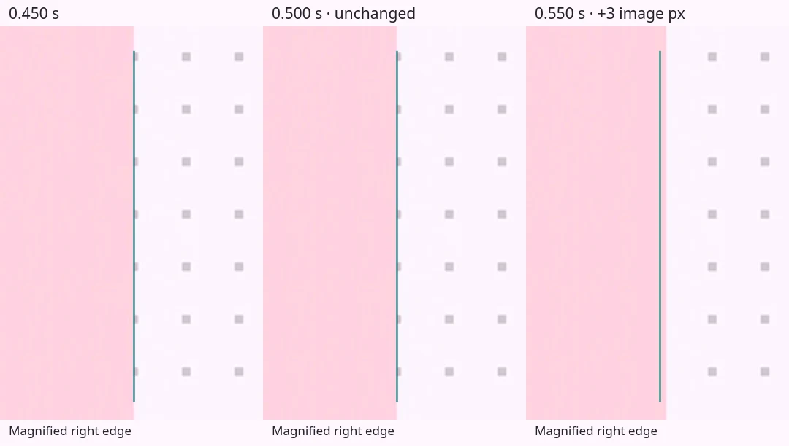

# Findings

## The symptom

During the final tail of a touch release on iOS, card edges pause for 50–117 ms
and then advance in small steps. V5 (current baseline) and V8 (whole-pixel
settling) are smooth on desktop; touch settling stutter remains on iPhone and
iPad. Handing off to custom JavaScript animation on touch release (V9) smooths
the initial release but introduces late native corrections and boundary
overscroll.

## Input paths in V5 (current baseline)

| Input | Dragging | Settling |
| --- | --- | --- |
| Touch / Trackpad | Native scrolling | Native inertia and CSS scroll snap |
| Mouse | Scripted dragging | 300 ms MD3 standard easing (Web Animations clock) |
| Arrow buttons / Keyboard | — | 300 ms MD3 standard easing (Web Animations clock) |

## Native scroll offsets on iOS

Across two native-touch captures (442 samples: iPad DPR 2, iPhone DPR 3), every
sampled horizontal scroll offset was a whole CSS pixel. Final 1 CSS px steps
arrived 50–116 ms apart even though `requestAnimationFrame` kept firing roughly
every 17 ms.

Because card geometry follows those offsets, the same symptom appears in
Uncontained, Full-screen, and Hero layouts—the multi-browse endpoint blend is
not required to reproduce it.

In matched iOS captures (Uncontained / Large / LTR, 396 px viewport, 320 px
cards, 8 px gaps, DPR 3), return gestures released near 130 px took 748 ms (V1)
and 739 ms (V5) to reach zero, spending ~450 ms on the final 10 px with holds up
to 117 ms. Forward/backward swipes showed the same 83–117 ms tail holds on both
V1 and V5.

## Diagnostic results (V6–V9)

| Version | Result |
| --- | --- |
| V6 · Fixed masks | Still stutters, with gaps and overlaps. |
| V7 · Native-flow control | Smoother on iOS (edge advances in smaller increments), though JSON offsets stay integer CSS px; desktop scroll-wheel settling still steps. |
| V8 · Whole-pixel settling | Smooth mouse release on desktop (brief 2-frame hold; target quality for iOS). Touch release still uses native settling on iOS (holds up to 117 ms). |
| V9 · Custom touch settling | Smooth initial release (21 distinct CSS positions over 322 ms), but native inertia can continue after the custom clock finishes—causing late 6–7 CSS px jumps, a 331 px rollback to the wrong item in capture `b6370a93`, or boundary overscroll. |

## Desktop comparison

In Firefox on Linux, V1 and V7 felt stuttery (50–67 ms video holds; 77–118 ms
offset holds), while V8 and V5 felt smooth. Because V8 rounds custom settling to
whole pixels and still looks smooth on desktop, integer positions alone do not
explain the iOS stutter.

## Boundary overscroll (V9)

The [annotated frames](site/assets/overscroll-annotated.webp) and
[video](site/assets/overscroll.mp4) show item 2 returning to item 1: native
rubber-banding reaches −275 CSS px while the first card's translation stays
clamped at 0, shifting the whole scrolling layer right and leaving blank space
before snapping back.

## Release traces and annotation notes

- **Time 0 ms:** Anchored to the in-viewport `touchend` on iOS, `pointerup` on
  PC, or the arrow-button event for V7 on PC.
- **Reference curve:** 300 ms `cubic-bezier(0.2, 0, 0, 1)` (MD3 standard easing)
  from the sampled position at release to the intended target.
- **Hold classification:** Annotated clips preserve variable source timestamps
  via FFmpeg passthrough; a hold requires at least two captured frames at the
  same tracked edge. Full measurements live in
  `site/assets/recordings/ios-measurements.json`.

## Device reports

| Device | Observed behavior |
| --- | --- |
| PC (Linux / Firefox) | V5 and V8 smooth; V1 and V7 stutter. |
| MacBook Air M4 | Smooth in latest test. |
| iPhone 15, iPhone 13 Pro Max, iPad Air (5th gen) | Touch settling stutter across Safari, Chrome, Firefox, and Brave. |

## Open questions

- Root cause of the earlier desktop stutter.
- Interaction between residual native inertia, deferred scroll writes, and snap
  restoration on iOS.
- Owning horizontal touch gestures without breaking vertical page scroll or
  pinch zoom.
- Handoff behavior during rapid swipes, interruption, direction changes, RTL,
  resize, focus, and reduced motion.
