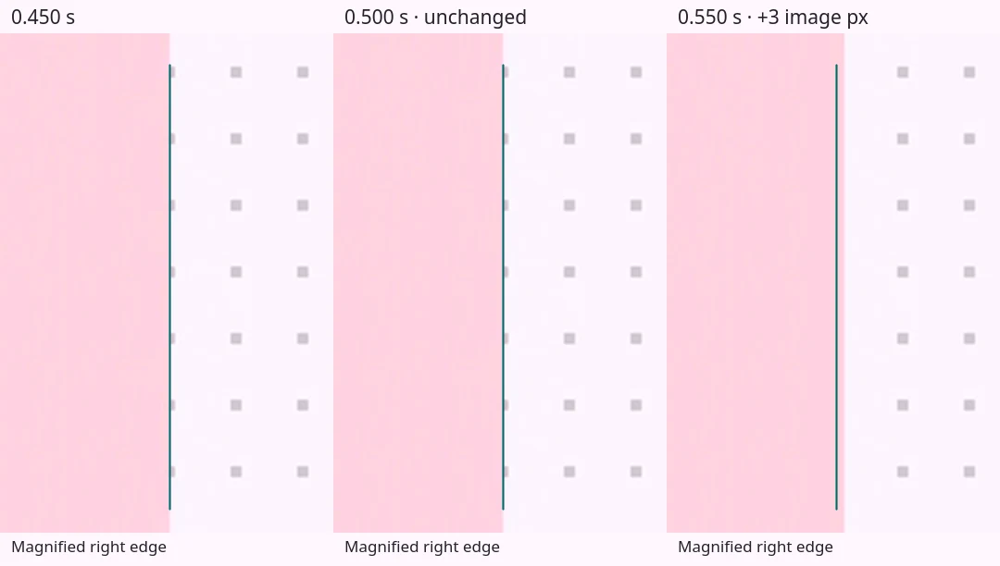
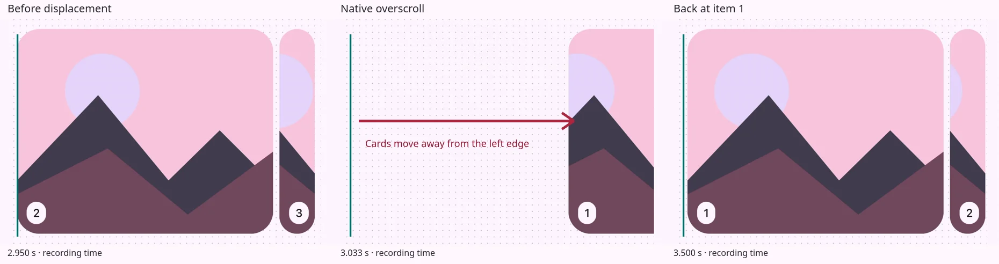

# Carousel Motion Lab

The carousel in [Token Catalog](https://tokencatalog.dev/md3/components/carousel) stutters as it slows down after a drag. Dragging itself usually feels smooth. The last part of the release can pause, advance in small steps, or jump.

**[Try it](https://sojupie.github.io/carousel-motion-lab/)** · [Measurements and findings](FINDINGS.md) · [Open a pull request](https://github.com/sojupie/carousel-motion-lab/compare)



The edge holds for 50 ms, then advances three recording pixels. The annotated videos on the test page slow this down and keep a history of the holds beside the recording.

## What changed

The Material Design 3 carousel changes each card’s visible width as it moves through the layout. The artwork keeps its original size inside the mask.

The first version followed native scroll events. Later attempts used an MD3 animation clock, explicit artwork offsets, and a single scroll synchronization at the end of the animation. These improved desktop motion. Touch release still stepped on several iPhones and an iPad.

The experiments then tried fixed mask widths, fixed-width cards with entirely native scrolling, rounded animation positions, and a handoff from native touch dragging to a custom animation. Touch handoff initially felt smoother. Further testing exposed a large jump at the boundary:



The latest desktop comparison found stutter in Original and Native. Rounded looks comparable to the current baseline. Its brief two-frame hold is acceptable and provides the settling target for iOS. The recordings and traces are in [FINDINGS.md](FINDINGS.md); all nine versions remain available on the test page.

## What a fix needs to preserve

- Smooth dragging, release, and interruption.
- Changing card masks with stable artwork proportions.
- Native vertical scrolling and pinch zoom.
- Keyboard navigation, RTL, and reduced motion.

A fix or a smaller reproduction is welcome. [Open a pull request](https://github.com/sojupie/carousel-motion-lab/compare) with the implementation tested, browser, device, input method, and a before-and-after recording. [Open an issue](https://github.com/sojupie/carousel-motion-lab/issues/new) for measurements or reproduction steps.

## Versions

| Version | Change | Observed result |
|---|---|---|
| Original | Native smooth scrolling with queued geometry updates. | Stutter on desktop and iOS. |
| Token clock | MD3-timed settling with native scroll writes on each frame. | Remaining roughness during settling. |
| One visual clock | Fractional settling and artwork offsets with native synchronization at completion. | Smoother desktop motion with remaining touch jitter and stutter. |
| Overscroll clamp + hints | Boundary clamping with layout containment and compositor hints. | Reduced directional jitter with remaining settling stutter. |
| Current baseline | Sticky track and boundary clamping without layout hints. | Smoother desktop motion with remaining touch settling steps. |
| Fixed masks | Fixed mask widths and artwork offsets with scroll-driven positions. | Remaining stutter, gaps, and overlaps. |
| 1 · Native scrolling | Fixed-width cards in normal flow. | Smoother initial phone tests; desktop scroll-wheel settling still steps. |
| 2 · Rounded clock | Whole-pixel positions during custom settling. | Smooth mouse-release settling in the latest desktop test. |
| 3 · Touch handoff | Native dragging followed by fractional custom settling. | Smoother initial settling with late corrections and boundary overscroll. |

Compare slow drags, release, and arrow-button navigation with the same device and settings. The Native control supports touch, trackpad, and scroll-wheel input. The Rounded control changes arrow-button and mouse-release settling.

Default settings: Original, Uncontained, Large, 640 px maximum width, LTR. Query parameters retain the configuration:

```text
?version=touch-handoff&variant=uncontained&size=large&width=640&direction=ltr
```

## Recording

1. Load the implementation and settings.
2. Press **Start recording**.
3. Perform the gestures.
4. Press **Stop recording** after the carousel settles.
5. Press **Download JSON**.

Each recording can contain several gestures. Recording also stops when the page is hidden or the 60-second limit is reached. The last five recordings stay in tab memory. Download before changing settings or reloading.

Reports contain browser and display settings, runtime hashes, input events, frame timestamps, native scroll offsets, and assigned CSS values. Data stays in tab memory until downloaded. Pair the JSON with a screen recording to compare CSS values with rendered motion. Repeat without recording to check instrumentation overhead.

## Local development

Node builds the static files and runs the tests. Python serves the site. There are no package dependencies.

```sh
npm run build
npm test
python3 -m http.server 8083 --directory site
```

Open `http://localhost:8083/`. For LAN access, bind the server to the network interface and allow the port through the firewall.

## Files

- `src/`: baseline, native control, and touch-handoff code.
- `src/history/`: earlier implementations and the fixed-mask diagnostic.
- `scripts/build.mjs`: runtime generation, hashes, and page asset URLs.
- `site/`: page, recorder, styles, generated runtimes, and visual evidence.
- `tests/`: recording, gesture, runtime, and snapshot checks.
- `FINDINGS.md`: measurements and open questions.

Each generated version starts from its own snapshot or the current baseline. The build checks each injection point and hashes the output. Run `npm run build` after editing source or page assets. Generated files are committed for static hosting.

## Publishing

```sh
git push origin main
./scripts/publish.sh
```

The publish script builds, tests, and pushes the static site to `gh-pages`. GitHub Pages serves that branch’s root directory.

## Page styles and recordings

The page uses a small snapshot of the Material light/default tokens and the button, filter-chip, and menu rules it needs. The filter pills and selection runtime come from the component previews. Selections apply immediately. Roboto is self-hosted; Material Symbols use inline SVG paths. The full theme stylesheet is not loaded.

Regular text is 16 px. Labels and supporting text are 16 px or larger. These reading-size adjustments apply to the page; the frozen carousel palette, geometry, and 300 ms timing remain scoped to each specimen.

To refresh the Material snapshot from the source repository and its generated theme:

```sh
node scripts/extract-material.mjs /path/to/tokens /path/to/theme.css
npm run build
```

The refresh script uses the source repository’s installed PostCSS. Serving and building this repository require no package dependencies. Roboto’s license is in `site/assets/fonts/OFL.txt`. Material Symbols use Apache-2.0; the license is in `site/assets/material-symbols-LICENSE.txt`.

The page shows Rounded as the desktop target alongside the two iOS examples. All annotated clips use 1280 × 720 frames, with the component on the left and the hold history on the right. Regular settling clips play at ¼ speed. The overscroll clip plays at ⅛ speed. Each clip ends with a four-second freeze and links to its hold summary. Raw recordings and device reports stay local.

Source license: [Business Source License 1.1](LICENSE).
