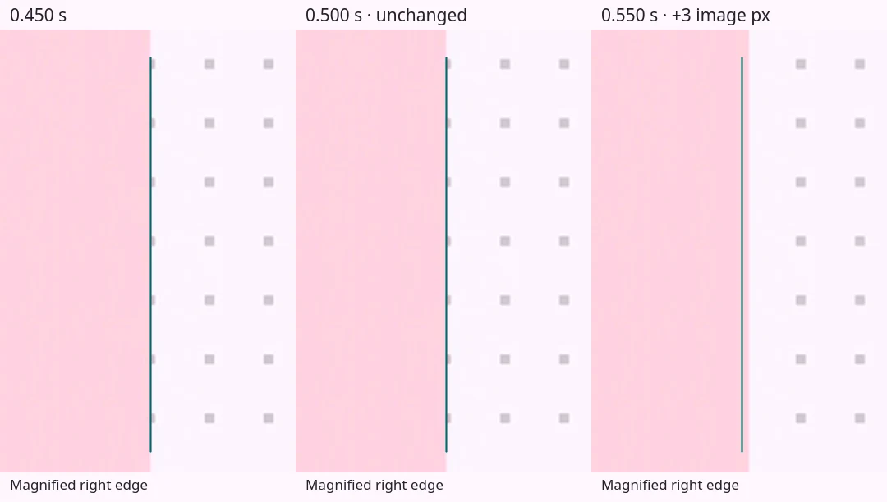
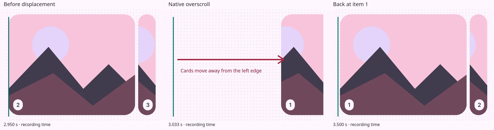

# Carousel Motion Lab

Interactive testbed for investigating carousel settling stutter and overscroll
on iOS.

The Material Design 3 carousel in
[Token Catalog](https://tokencatalog.dev/md3/components/carousel) changes each
card's visible width while keeping its artwork at a fixed size. V5 (the current
baseline) is smooth on desktop, while touch swipes on iPhone and iPad still
pause and step as they slow down—or overshoot and snap back under custom touch
handoff (V9).

**[Try the playground](https://tokencatalog.dev/tools/carousel-playground/)** · [GitHub Pages mirror](https://sojupie.github.io/carousel-motion-lab/) · [Findings](FINDINGS.md) · [Open a PR](https://github.com/sojupie/carousel-motion-lab/compare)



## Versions

| Version | Implementation |
| --- | --- |
| V1 · Original native scrolling | Native smooth scrolling with queued geometry updates. |
| V2 · MD3-timed settling | Custom animation clock writing native scroll positions each frame. |
| V3 · Synchronized visual settling | Explicit artwork positioning; syncs native scroll on completion. |
| V4 · Boundary clamping | Adds boundary clamping, layout containment, and compositor hints. |
| V5 · Current baseline | Sticky track and boundary clamping without layout hints. |
| V6 · Fixed masks | Freezes card widths to isolate position updates. |
| V7 · Native-flow control | Fixed-width cards in normal flow. |
| V8 · Whole-pixel settling | Rounds positions to whole pixels during custom settling. |
| V9 · Custom touch settling | Switches from native dragging to custom animation at touch release. |

V8 matches V5 on desktop and serves as the settling target for iOS. V9 can
settle more smoothly on iOS, but triggers late corrections and boundary
overscroll:



See [FINDINGS.md](FINDINGS.md) for traces and measurements.

## Record and inspect a test

1. Choose a version and layout, press **Start recording**, drag or flick the
   carousel, and let it settle.
2. Press **Stop recording** and **Download JSON**. Recordings stay in your tab
   (up to five survive settings changes; nothing is uploaded; recording stops
   after 60 s or when hidden).
3. To plot your export against the 300 ms MD3 reference curve, switch **Release
   traces** to **Your recording** → **Choose JSON**.

Pair the JSON (input events, frame timestamps, native scroll offsets, assigned
CSS values) with a screen recording to compare assigned values against rendered
frames.

## Contribute

[Open a pull request](https://github.com/sojupie/carousel-motion-lab/compare)
with a fix or smaller reproduction (include version, browser, device, input
method, and before/after recordings), or
[open an issue](https://github.com/sojupie/carousel-motion-lab/issues/new) with
measurements.

Keep the cards' changing widths and fixed artwork proportions, and preserve
vertical page scrolling, pinch zoom, keyboard navigation, and reduced motion.

## Run locally

Requires Node.js, Go 1.26+, and a sibling Token Catalog checkout at `../tokens`
to build the shared navigation and footer.

```sh
npm run build
npm test
python3 -m http.server 8083 --directory site
```

Open [localhost:8083](http://localhost:8083/).

- `src/` — carousel scripts and styles (`src/history/` holds earlier versions).
- `site/` — static page, recorder, traces, media, and generated runtimes.
- `scripts/build.mjs` — builds all nine versions and hashes assets.
- `tests/` — interaction, recording, and build checks.

Run `npm run build` after editing code or page assets and commit the rebuilt
files in `site/`. To publish to `gh-pages`:

```sh
git push origin main
./scripts/publish.sh
```

[Business Source License 1.1](LICENSE). Font and icon licenses live in
[`site/assets/`](site/assets/).
